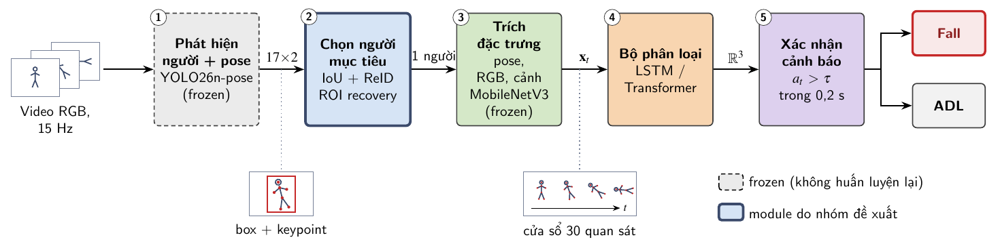
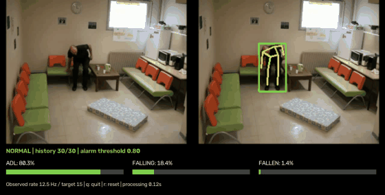
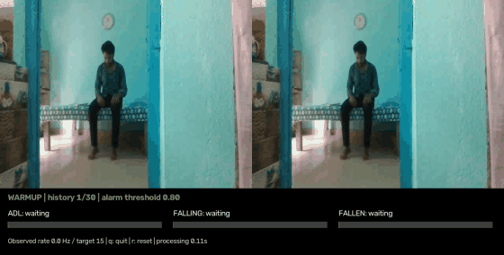
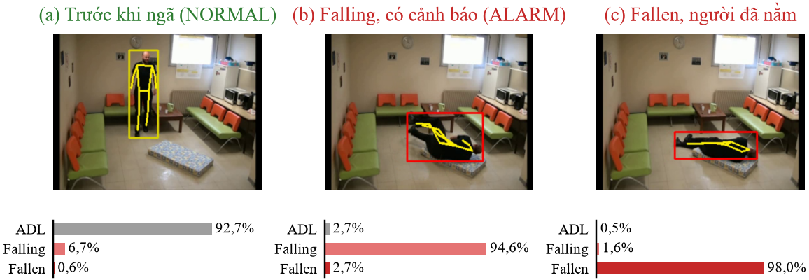
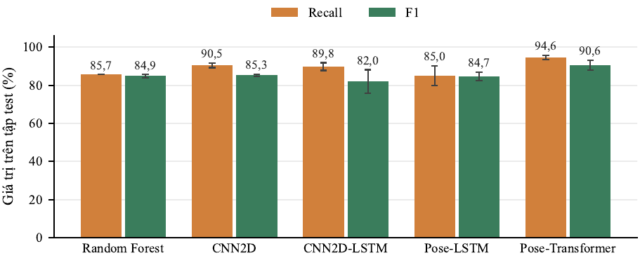
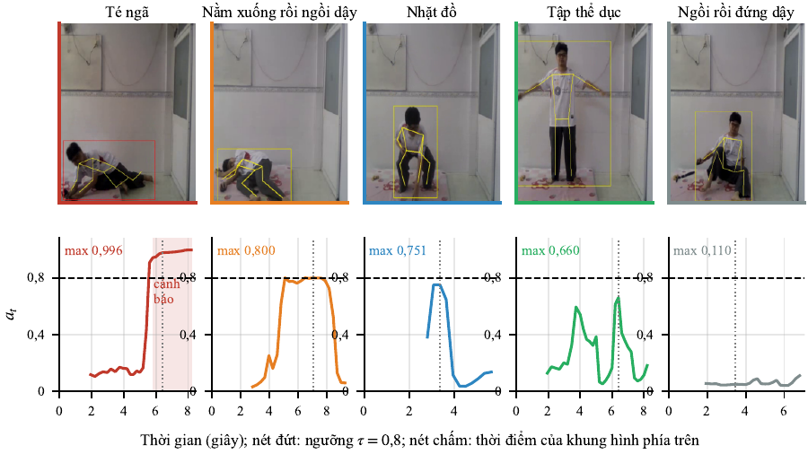

# Phát hiện té ngã từ video

Bài tập lớn môn Xử lý ảnh số và Thị giác máy tính (CO3057), Nhóm 06, Trường Đại học Bách khoa – ĐHQG TP.HCM.

## Thành viên

| Họ và tên | MSSV |
|---|---|
| Đặng Châu Anh | 2310063 |
| Lê Trần Bảo Nhi | 2312499 |
| Nguyễn Đăng Khoa | 2311614 |
| Vũ Huy Gia Khang | 2311486 |

## Bài toán

- **Input:** video RGB từ một camera cố định trong nhà (file video hoặc webcam).
- **Output:** trạng thái của người tại từng thời điểm (ADL, Falling, Fallen), thời điểm phát cảnh báo té ngã, nhãn của cả clip (Fall/ADL) cùng video có vẽ box, skeleton và xác suất.
- **Phạm vi:** mỗi video có một người cần theo dõi; mọi bước chạy được trên CPU.

## Pipeline



Video được lấy mẫu 15 Hz rồi đi qua năm bước. Khối viền đứt là mô hình có sẵn được giữ nguyên trọng số (frozen), khối viền đậm là thành phần nhóm đề xuất.

| Bước | Vai trò |
|---|---|
| Phát hiện người + pose | YOLO26n-pose (frozen) trả về box và 17 keypoint cho mỗi khung |
| Chọn người mục tiêu | Nối các phát hiện thành chuỗi của đúng một người; lấy lại pose khi người nằm sát sàn |
| Trích đặc trưng | Keypoint chuẩn hóa, 12 đại lượng hình học và chuyển động, vector ảnh 576 chiều, vector cảnh 8 chiều |
| Bộ phân loại chuỗi | Ước lượng xác suất ADL / Falling / Fallen cho quan sát cuối của mỗi cửa sổ |
| Xác nhận cảnh báo | Chỉ phát cảnh báo khi điểm cảnh báo vượt ngưỡng đủ lâu, giảm cảnh báo nhầm do nhiễu |

## Demo

| Le2i (Coffee room) | GMDCSA24 |
|---|---|
|  |  |

Hai GIF được tạo bằng checkpoint `checkpoints/pose_lstm_scene.pt` trên video thuộc tập test, không dùng khi huấn luyện. Video demo đầy đủ nằm trên **[Google Drive](https://drive.google.com/drive/folders/1N4YLEj7Weh0W58Q35rXoLzLWfhmBzGtB?usp=sharing)**, gồm hai thư mục:

- `test_video/`: clip thuộc tập test của Le2i, CAUCAFall, GMDCSA24. Các file đánh số `1_` đến `6_` là sáu clip được phân tích trong báo cáo (TN, TP, hai FP, hai FN).
- `ours_video/`: năm clip nhóm tự quay, không thuộc bộ dữ liệu nào (té ngã, nằm xuống, nhặt đồ, đứng dậy, tập thể dục).

Mỗi video ghép khung gốc bên trái với kết quả bên phải (box, skeleton, xác suất ba trạng thái và trạng thái cảnh báo).



Ba khung hình trên một video test của Le2i: trước khi ngã (NORMAL), đang ngã và đã cảnh báo (ALARM), rồi đã nằm trên sàn (Fallen).

## Kết quả

Đánh giá trên 95 video test, chia theo người (người trong tập test không xuất hiện khi huấn luyện). Số liệu là trung bình ± độ lệch chuẩn qua 3 seed (17, 42, 73); F1 tính theo clip, ngưỡng chọn trên validation.

| Mô hình | Precision | Recall | F1 test | Độ trễ cảnh báo |
|---|---:|---:|---:|---:|
| Random Forest | 84,0 | 85,7 | 84,9 ± 0,9 | 1,41 s |
| CNN2D (MobileNetV3) | 80,6 | 90,5 | 85,3 ± 0,6 | 1,39 s |
| CNN2D-LSTM | 75,7 | 89,8 | 82,0 ± 6,2 | 1,41 s |
| Pose-LSTM | 84,5 | 85,0 | 84,7 ± 2,3 | 1,50 s |
| Pose-LSTM + đặc trưng cảnh | 90,8 | 92,5 | **91,6 ± 2,3** | 1,40 s |
| Pose-Transformer | 87,2 | **94,6** | 90,6 ± 2,6 | 1,41 s |



### Thử trên video tự quay

Năm clip quay trong một căn phòng không có trong dữ liệu huấn luyện, chạy bằng chương trình demo với mô hình Pose-LSTM + đặc trưng cảnh (ngưỡng 0,8):



| Clip | Điểm cảnh báo cao nhất | Kết quả |
|---|---:|---|
| Té ngã | 0,996 | Cảnh báo ở giây 5,8 (đúng) |
| Nằm xuống rồi ngồi dậy | 0,800 | Không cảnh báo, nhưng sát ngưỡng |
| Nhặt đồ | 0,751 | Không cảnh báo (đúng) |
| Tập thể dục | 0,660 | Không cảnh báo (đúng) |
| Ngồi rồi đứng dậy | 0,110 | Không cảnh báo (đúng) |

Hệ thống phát hiện đúng cú ngã ở phòng mới, nhưng biên an toàn với các động tác cúi và nằm còn nhỏ; đây là hạn chế chính đã nêu trong báo cáo.

Phân tích chi tiết, các thí nghiệm ablation và trường hợp lỗi nằm trong báo cáo PDF nộp kèm.

## Cài đặt

Cần Python ≥ 3.10 (đã kiểm tra với Python 3.12). Chạy mọi lệnh từ thư mục gốc của repo.

```bash
git clone https://github.com/giakhang1704/cv-fall-detection.git
cd cv-fall-detection
python -m venv .venv
.venv\Scripts\activate          # Windows
source .venv/bin/activate       # Linux / macOS
pip install -r requirements.txt
pip install -e .
python tools/download_weights.py
```

`download_weights.py` tải YOLO26n-pose và mô hình ReID của Ultralytics rồi kiểm tra mã SHA-256. `requirements.txt` ghi đúng phiên bản thư viện đã dùng để tạo kết quả.

## Chạy demo

Không cần tải dữ liệu huấn luyện, vì repo có sẵn hai checkpoint trong `checkpoints/`.

```bash
python tools/camera_demo.py --source path/to/video.mp4      # một file video
python tools/camera_demo.py                                  # webcam, nhấn q để thoát
python tools/camera_demo.py --source path/to/video.mp4 --checkpoint checkpoints/pose_transformer.pt --headless
```

Kết quả (`demo.mp4`, `predictions.csv`) được lưu trong `outputs/demos/`. Trạng thái hiển thị trên video: WARMUP (chưa đủ 30 quan sát), NORMAL, SUSPECT (điểm cảnh báo vượt ngưỡng, đang chờ xác nhận), ALARM (đã cảnh báo).

Tạo GIF từ một video demo:

```bash
python tools/make_demo_gif.py outputs/demos/<run>/demo.mp4 assets/demo/demo.gif --width 560 --fps 8
```

## Dữ liệu

Repo không chứa video. Tải ba bộ dữ liệu công khai:

| Bộ dữ liệu | Số video dùng | Nguồn |
|---|---:|---|
| CAUCAFall | 100 | [Mendeley Data](https://data.mendeley.com/datasets/7w7fccy7ky/4) (bản 4) |
| GMDCSA24 | 160 | [GitHub](https://github.com/ekramalam/GMDCSA24-A-Dataset-for-Human-Fall-Detection-In-Videos) |
| Le2i | 187 | [dataUBFC](https://search-data.ubfc.fr/imvia/FR-13002091000019-2024-04-09_Fall-Detection-Dataset.html) (DOI [10.25666/DATAUBFC-2024-04-09](https://doi.org/10.25666/DATAUBFC-2024-04-09), file `FallDataset.zip`, 8,95 GB) |

Trang giới thiệu cũ của Le2i trên website ImViA hiện chưa có link tải, nên cần tải từ kho dataUBFC ở trên. Bộ này có 191 video, trong đó 190 video có nhãn OmniFall; repo dùng 187 video sau khi bỏ thêm 3 video trùng nội dung (cùng mã SHA-256).

Đặt video vào `data/raw/` theo đúng cột `video_path` của `data/manifests/videos.csv`; nếu tên tệp hoặc thư mục trong bản tải về khác, đổi lại cho khớp. Ví dụ:

```
data/raw/CAUCAFall/Subject.1/Fall backwards/FallBackwardsS1.avi
data/raw/GMDCSA24/Subject 1/ADL/01.mp4
data/raw/Le2i/Coffee_room_01/video_23.avi
```

Repo có sẵn:

- `data/manifests/`: danh sách 447 video, cách chia theo người (283 train / 69 val / 95 test) và nhãn thời gian ba trạng thái.
- `data/annotations/`: nhãn gốc của các bộ dữ liệu, lấy từ [OmniFall](https://arxiv.org/abs/2505.19889) (CAUCAFall, Le2i) và từ tệp chú thích gốc của GMDCSA24.

Kiểm tra mã băm của video sau khi tải (mất vài phút):

```bash
python run.py audit
```

## Tái lập thực nghiệm

**1. Trích pose.** YOLO chạy một lần cho mọi video (vài giờ trên CPU); kết quả ghi vào `outputs/preprocessing_full/pose_cache/none/`.

```bash
python run.py extract-pose
python run.py extract-pose --split val --limit 3 --output outputs/pose_test   # thử nhanh 3 video
```

**2. Huấn luyện và đánh giá.** Mỗi lệnh tự tạo đặc trưng rồi huấn luyện ba seed.

```bash
python tools/run_experiments.py --phase baselines --seeds 17 42 73 --evaluate-test
python tools/run_experiments.py --phase rgb_preprocessing --seeds 17 42 73 --evaluate-test
python tools/run_experiments.py --phase scene --seeds 17 42 73 --evaluate-test
python tools/run_temporal_ablation.py --factor model --seeds 17 42 73 --evaluate-test
python tools/run_temporal_ablation.py --factor features --seeds 17 42 73 --evaluate-test
python tools/run_temporal_ablation.py --factor history --seeds 17 42 73 --evaluate-test
```

| Lệnh | Thí nghiệm trong báo cáo |
|---|---|
| `run_experiments.py --phase baselines` và `run_temporal_ablation.py --factor model` | TN1: Random Forest, CNN2D, CNN2D-LSTM, Pose-LSTM, Pose-Transformer |
| `run_experiments.py --phase rgb_preprocessing` | TN2: tiền xử lý ảnh trước CNN2D (CLAHE, gamma, ...) |
| `run_experiments.py --phase scene` | TN3: thêm vector cảnh Canny + Hough |
| `run_temporal_ablation.py --factor features` | TN4: keypoint, hình học + chuyển động, thêm gia tốc |
| `run_temporal_ablation.py --factor history` | TN5: độ dài cửa sổ 30 / 45 / 90 quan sát |

Mỗi lần chạy được lưu trong `outputs/runs/<tên>/` (`best.pt`, `config.json`, `history.json`, `val_metrics.json`, `test_metrics.json`). Run đã có sẽ được dùng lại, không bị ghi đè.

## Chạy từng bước bằng `run.py`

```bash
python run.py --help
python run.py status
python run.py prepare --output outputs/prepared/my_data --rgb
python run.py train --data outputs/prepared/my_data --model pose_lstm --scene --run outputs/runs/my_run
python run.py evaluate --checkpoint outputs/runs/my_run/best.pt --split test
python run.py compare --runs outputs/runs/my_run outputs/runs/other_run --split test --output outputs/comparisons/my_compare
```

- `--model`: `rf`, `svm`, `cnn2d`, `cnn_lstm`, `pose_lstm`, `pose_transformer`.
- `--scene`: ghép vector cảnh vào đặc trưng.
- `--feature-set keypoints|motion|dynamics`: chọn nhóm đặc trưng pose.

Các tham số (tần số lấy mẫu, độ dài cửa sổ, ngưỡng, siêu tham số) nằm trong `configs/default.json`; có thể ghi đè bằng `python run.py --config my_config.json <lệnh>`. Mọi đường dẫn đều tương đối so với thư mục gốc của repo.

## Cấu trúc thư mục

```
configs/default.json          cấu hình chung
assets/demo/                  GIF demo hiển thị trong README
assets/figures/               hình pipeline và kết quả lấy từ báo cáo
checkpoints/                  hai checkpoint dùng cho demo
data/manifests/               danh sách video, cách chia tập, nhãn thời gian
data/annotations/             nhãn gốc của các bộ dữ liệu
src/fall_detection/           pipeline: pose, chọn người, đặc trưng, mô hình, huấn luyện, đánh giá
tools/                        chạy thí nghiệm, demo, tải weights, tạo GIF
tests/                        unit test
run.py                        giao diện dòng lệnh cho từng bước
```

Chạy unit test:

```bash
python -m unittest discover -s tests
```

## Nguồn tham khảo

- YOLO26n-pose và mô hình ReID: [Ultralytics](https://github.com/ultralytics/ultralytics) (AGPL-3.0).
- MobileNetV3-small với trọng số ImageNet: [torchvision](https://pytorch.org/vision/stable/models/mobilenetv3.html).
- Canny, Hough Transform, CLAHE: [OpenCV](https://opencv.org/); LSTM, Transformer Encoder: [PyTorch](https://pytorch.org/).
- Nhãn thời gian: [OmniFall](https://arxiv.org/abs/2505.19889). Dữ liệu: CAUCAFall, GMDCSA24, Le2i.

